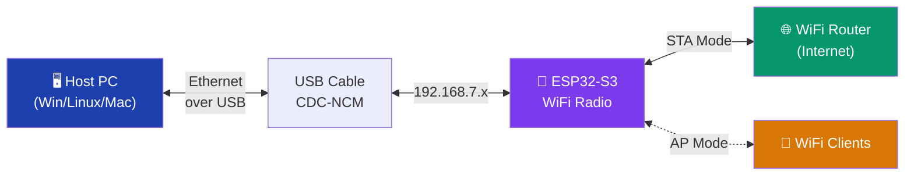

# ESP32-S3 USB WiFi Dongle — Complete Guide

## What This Does

Turns an **ESP32-S3** dev board into a **plug-and-play USB WiFi dongle** — just like a TP-Link or Realtek USB WiFi adapter you'd buy in a store.



### Two Modes — Just Like a Real WiFi Dongle

| Mode | What it does | Real-world equivalent |
|------|-------------|----------------------|
| **STA (Station)** | PC gets WiFi internet through the dongle | TP-Link USB WiFi adapter |
| **AP (Access Point)** | PC shares its internet as a WiFi hotspot through the dongle | WiFi hotspot dongle with AP mode |
| **AP+STA** | Both simultaneously | High-end USB WiFi dongle |

## Project Files

| File | Purpose |
|------|---------|
| [`ESP32S3-WiFi-Dongle.ino`](file:///home/yogesh/Arduino/ESP32S3-WiFi-Dongle/ESP32S3-WiFi-Dongle.ino) | Main sketch — all logic |
| [`sdkconfig.defaults`](file:///home/yogesh/Arduino/ESP32S3-WiFi-Dongle/sdkconfig.defaults) | Build flags for NAPT + USB-NCM |

## Hardware Requirements

- **ESP32-S3** dev board (e.g., ESP32-S3-DevKitC-1)
- USB cable connected to the **native USB-OTG port** (GPIO 19/20), NOT the UART bridge port

> [!IMPORTANT]
> Most ESP32-S3 dev boards have **two USB ports**. You must use the one labeled **USB** or **USB-OTG** — not the one labeled **UART** or **COM**.

## Arduino IDE Setup

> [!CAUTION]
> These settings are **critical**. The wrong USB Mode selection means the dongle won't work at all.

| Setting | Value |
|---------|-------|
| **Board** | ESP32S3 Dev Module |
| **USB Mode** | **USB-OTG (TinyUSB)** ← MUST select this |
| **USB CDC On Boot** | Disabled |
| **PSRAM** | OPI PSRAM (if your board has it) |
| **Partition Scheme** | Default 4MB or larger |
| **Upload Mode** | UART0 / Hardware CDC (for flashing) |

## How It Works — Technical Details

### USB-NCM (Network Control Model)

The ESP32-S3's native USB-OTG port presents itself as a **CDC-NCM** Ethernet adapter. NCM is the modern USB networking standard that replaced the older RNDIS and ECM protocols:

| Protocol | Windows | Linux | macOS | Status |
|----------|---------|-------|-------|--------|
| **CDC-NCM** ✓ | ✅ Native (Win 10+) | ✅ Native | ✅ Native | **Used by this project** |
| CDC-ECM | ❌ Needs driver | ✅ Native | ✅ Native | Linux/Mac only |
| RNDIS | ⚠️ Deprecated | ⚠️ Being removed | ❌ Never | Legacy, avoid |

### NAT Routing (NAPT)

```
PC (192.168.7.2)
    │
    │ USB-NCM (virtual Ethernet)
    │
ESP32 Gateway (192.168.7.1)  ──NAPT──►  WiFi STA (e.g., 192.168.1.105)  ──►  Internet
    │
    │ SoftAP (192.168.4.1)
    │
WiFi Clients (192.168.4.x)
```

NAPT (Network Address Port Translation) rewrites packet headers so:
- The PC's traffic appears to come from the ESP32's WiFi STA IP
- The WiFi router sees one client (the ESP32), not the PC
- Return traffic is translated back and forwarded to the PC

### IP Addressing

| Interface | Subnet | Gateway | DHCP Range |
|-----------|--------|---------|------------|
| USB (to PC) | 192.168.7.0/24 | 192.168.7.1 | .2 – .20 |
| SoftAP (WiFi hotspot) | 192.168.4.0/24 | 192.168.4.1 | auto |
| STA (uplink) | depends on router | router's GW | from router |

## First-Time Usage

1. **Flash** the sketch to your ESP32-S3
2. **Plug** the ESP32-S3 into your PC via the USB-OTG port
3. **Wait** 5-10 seconds — the PC should detect a new network adapter
4. **Open** `http://192.168.7.1` in your browser
5. **Click** "Scan available networks" to find WiFi networks
6. **Select** your WiFi network, enter the password
7. **Click** "Save & Reboot"
8. After reboot, the PC should have internet via the ESP32-S3's WiFi!

## LED Status Colors

| Color | Meaning |
|-------|---------|
| 🔵 Blue | STA connected (WiFi dongle active) |
| 🟢 Green | AP mode only (hotspot active) |
| 🟣 Purple | AP+STA both active |
| 🟠 Amber | USB up but no WiFi connection |
| ⚫ Off | Initializing |

## Troubleshooting

| Problem | Solution |
|---------|----------|
| PC doesn't detect network adapter | Ensure USB Mode is "USB-OTG (TinyUSB)" in Arduino IDE |
| Adapter detected but no IP | Wait 10s, or check if `sdkconfig.defaults` was included |
| "No internet" on the PC | Open `http://192.168.7.1` and configure STA WiFi credentials |
| Windows shows "Code 10" error | Ensure `sdkconfig.defaults` is in the sketch folder |
| Can't reach 192.168.7.1 | Try `ipconfig` / `ip addr` to verify the adapter got an IP |

## Comparison with NAT Repeater

| Feature | NAT Repeater | USB WiFi Dongle |
|---------|-------------|-----------------|
| Connection to PC | WiFi (PC connects to AP) | USB cable (plug & play) |
| PC sees | A WiFi network to join | A network adapter (like built-in WiFi) |
| Driver needed | None (WiFi) | None (NCM is native) |
| STA mode | ✅ Uplink to router | ✅ Uplink to router |
| AP mode | ✅ Broadcasts SSID | ✅ Broadcasts SSID |
| USB required | No (only for power) | Yes (data + power) |
| Best for | Extending WiFi range | Adding WiFi to a PC/laptop |

> [!NOTE]
> The `sdkconfig.defaults` file is essential. It enables `CONFIG_LWIP_IPV4_NAPT=y` (NAT routing) and `CONFIG_TINYUSB_NET_MODE_NCM=y` (USB network adapter). Without these build flags, the sketch will fail to compile or the USB adapter won't appear to the host OS.
