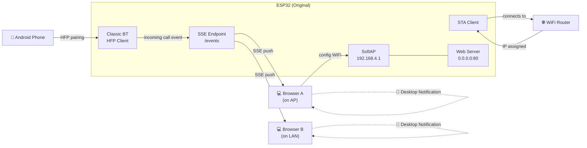
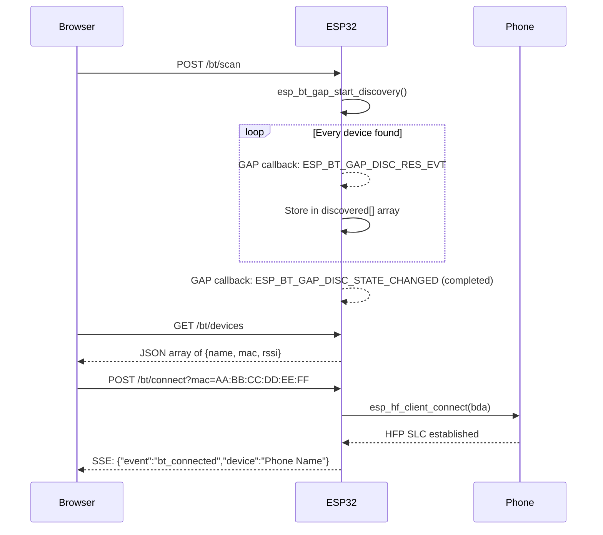
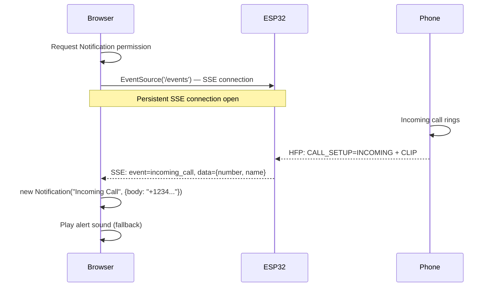

# ESP32 HFP Call Notifier — Implementation Plan

## Overview

A single Arduino sketch for the **original ESP32** (ESP32-WROOM-32 / ESP32-DevKitC) that:

1. Creates a WiFi **Access Point** for initial configuration
2. Connects as a **Station** to a user-specified WiFi AP (AP+STA mode)
3. Serves a web UI for **Bluetooth HFP** — scan, pair, and connect to an Android/phone
4. Detects **incoming phone calls** via HFP and pushes **desktop notifications** to all connected browsers

> [!IMPORTANT]
> **Must use original ESP32** (not S3/C3/C6). Only the original ESP32 has Classic Bluetooth (BR/EDR) needed for HFP.

---

## Architecture



---

## Phase 1: WiFi Configuration Portal

### What happens

| Step | Action |
|------|--------|
| 1 | ESP32 boots, starts **SoftAP** (`ESP32_CallNotifier` / password `12345678`) |
| 2 | User connects phone/laptop to ESP32's AP |
| 3 | User visits `http://192.168.4.1` → sees WiFi config page |
| 4 | User enters target WiFi SSID + password, clicks **Save** |
| 5 | ESP32 connects to the target AP as STA (**without rebooting** — AP stays up, connected devices stay connected) |
| 6 | Page updates to show the STA IP assigned by the router |

### Key design decisions

- **No reboot on save** — unlike the NAT-repeater, we call `WiFi.begin()` live and let the event handler report the new IP. The AP client's connection is undisturbed.
- **Credentials stored in NVS** (Preferences) — on next boot, auto-connects.
- **WiFi mode**: `WIFI_AP_STA` from the start.
- **Web server binds to `0.0.0.0:80`** — accessible from both AP subnet (192.168.4.x) and LAN subnet.

### Web page: WiFi Config

Single-page with:
- SSID input (text)
- Password input (password)
- **Save** button (POST to `/save-wifi`)
- Status panel showing: connection state, STA IP, Gateway, DNS
- Auto-refresh status via JavaScript `fetch('/status')` every 3 seconds after save (no page reload)

---

## Phase 2: Bluetooth HFP Connection

### Initialization sequence

```
1. esp_bt_controller_init()          — init BT controller
2. esp_bt_controller_enable(CLASSIC) — enable Classic BT mode
3. esp_bluedroid_init() + enable()   — init Bluedroid stack
4. esp_bt_gap_register_callback()    — for device discovery
5. esp_hf_client_register_callback() — for HFP events
6. esp_hf_client_init()             — init HFP client profile
7. esp_bt_dev_set_device_name()      — "ESP32_CallNotifier"
8. esp_bt_gap_set_scan_mode()        — connectable + discoverable
```

### Web page: Bluetooth Manager

Served on the **same web server** (separate page at `/bt` or a tab/section on the main page).

| UI Element | Action |
|------------|--------|
| **Scan** button | Triggers `esp_bt_gap_start_discovery()` — 10 sec scan |
| Device list | Shows discovered devices (name + MAC address) |
| **Connect** button per device | Calls `esp_hf_client_connect(bda)` |
| Connection status | Shows: Disconnected / Connecting / Connected / Call Active |
| **Disconnect** button | Calls `esp_hf_client_disconnect(bda)` |
| Connected device info | Shows paired phone name + address |

### BT scanning flow



### Stored state

- Last connected device MAC stored in NVS → auto-reconnect on boot.

---

## Phase 3: Incoming Call Detection & Desktop Notifications

### HFP callback events to handle

| Event | What it tells us | Action |
|-------|-----------------|--------|
| `ESP_HF_CLIENT_CONNECTION_STATE_EVT` | HFP link up/down | Update UI status |
| `ESP_HF_CLIENT_CIND_CALL_SETUP_EVT` | Call setup state changed | **Detect incoming call** when `status == INCOMING` |
| `ESP_HF_CLIENT_CLIP_EVT` | Caller ID (phone number) | Include in notification |
| `ESP_HF_CLIENT_CIND_CALL_EVT` | Call active/inactive | Detect call answered/ended |

### SSE (Server-Sent Events) push mechanism

**Endpoint**: `GET /events`

The ESP32 maintains a list of connected SSE clients (up to 8). When an HFP event occurs:

```
event: incoming_call
data: {"number":"+1234567890","name":"John Doe"}

event: call_ended
data: {}

event: bt_status
data: {"connected":true,"device":"Pixel 7"}
```

### Browser-side notification flow



### Desktop Notification — Secure Context Limitation

> [!WARNING]
> The **Web Notifications API** requires a **secure context** (HTTPS or localhost).
> - **Firefox**: Still allows notifications on plain HTTP (works out of the box)
> - **Chrome/Edge**: Blocks on HTTP. Workaround: navigate to `chrome://flags/#unsafely-treat-insecure-origin-as-secure`, add the ESP32's LAN IP (e.g. `http://192.168.1.42`)
> - **Safari**: Requires HTTPS

### Mitigation strategy (implemented in order of priority)

1. **Audio alert** — Always works. The page plays a ringtone sound via `<audio>` when SSE event arrives. No permissions needed. This is the **primary** notification method.
2. **Web Notification API** — Attempted as secondary. If `Notification.permission` can be granted, show desktop notification with caller info. Works on Firefox HTTP; Chrome needs the flag.
3. **Visual alert** — Page flashes / shows large banner with caller info. Always works as fallback.
4. *(Optional future)* Self-signed HTTPS on ESP32 using `esp_https_server` — adds complexity, user must accept cert.

---

## Phase 4: Web UI Design

### Page structure

Single-page app at `/` with two sections:

```
┌─────────────────────────────────────────┐
│  📡 ESP32 Call Notifier                 │
├─────────────────────────────────────────┤
│                                         │
│  ┌─── WiFi Configuration ────────────┐  │
│  │ SSID: [___________]               │  │
│  │ Pass: [___________]               │  │
│  │ [Save WiFi]                       │  │
│  │                                   │  │
│  │ Status: ● Connected               │  │
│  │ STA IP: 192.168.1.42              │  │
│  │ Gateway: 192.168.1.1              │  │
│  └───────────────────────────────────┘  │
│                                         │
│  ┌─── Bluetooth (HFP) ──────────────┐  │
│  │ [Scan for Devices]                │  │
│  │                                   │  │
│  │ Found:                            │  │
│  │  📱 Pixel 7  (AA:BB:CC:DD:EE:FF) │  │
│  │     [Connect]                     │  │
│  │  📱 Galaxy S24 (11:22:33:44:55)   │  │
│  │     [Connect]                     │  │
│  │                                   │  │
│  │ Connected to: Pixel 7 ● (HFP)    │  │
│  │ [Disconnect]                      │  │
│  └───────────────────────────────────┘  │
│                                         │
│  ┌─── Call Notifications ────────────┐  │
│  │ [🔔 Enable Desktop Notifications] │  │
│  │ Status: Notifications enabled ✓   │  │
│  │                                   │  │
│  │ Last call: +1234567890            │  │
│  │   at 14:32:05                     │  │
│  └───────────────────────────────────┘  │
│                                         │
└─────────────────────────────────────────┘
```

### API endpoints

| Method | Path | Purpose |
|--------|------|---------|
| `GET`  | `/` | Main HTML page |
| `POST` | `/save-wifi` | Save WiFi credentials + connect (no reboot) |
| `GET`  | `/status` | JSON: WiFi status, BT status, connected device |
| `POST` | `/bt/scan` | Start BT discovery |
| `GET`  | `/bt/devices` | JSON array of discovered devices |
| `POST` | `/bt/connect` | Connect HFP to device (param: `mac`) |
| `POST` | `/bt/disconnect` | Disconnect HFP |
| `GET`  | `/events` | SSE stream for real-time events |

---

## File Structure

```
Arduino/
└── ESP32_CallNotifier/
    ├── ESP32_CallNotifier.ino    ← Main sketch (single file)
    └── sdkconfig.defaults        ← Build-time BT + coexistence config
```

### sdkconfig.defaults contents

```
CONFIG_BT_ENABLED=y
CONFIG_BT_BLUEDROID_ENABLED=y
CONFIG_BT_CLASSIC_ENABLED=y
CONFIG_BT_HFP_HF_ENABLE=y
CONFIG_BT_HFP_AUDIO_DATA_PATH_PCM=y
CONFIG_ESP_COEX_SW_COEXIST_ENABLE=y
CONFIG_PM_ENABLE=n
```

> [!NOTE]
> `AUDIO_DATA_PATH_PCM` is set because we don't need to process audio — we just need the signaling. No I2S/codec hardware needed since we're only detecting calls, not handling audio.

---

## Code Organization (within single .ino file)

```
1.  Includes & defines
2.  Global state variables
3.  NVS load/save helpers
4.  WiFi event handler (AP+STA, auto-reconnect)
5.  BT GAP callback (discovery results)
6.  HFP client callback (connection state, incoming call, caller ID)
7.  SSE client manager (add/remove/broadcast)
8.  Web server handlers:
    a. handleRoot()         — serve HTML page
    b. handleSaveWifi()     — save + WiFi.begin() live
    c. handleStatus()       — JSON status
    d. handleBtScan()       — start discovery
    e. handleBtDevices()    — return discovered list
    f. handleBtConnect()    — initiate HFP
    g. handleBtDisconnect() — disconnect HFP
    h. handleEvents()       — SSE stream
9.  setup()
    a. Serial + NVS
    b. WiFi AP+STA init
    c. BT controller + Bluedroid + GAP + HFP init
    d. Auto-reconnect to saved BT device
    e. Web server routes + begin
10. loop()
    a. server.handleClient()
    b. SSE keepalive pings (every 30s)
    c. BT reconnect check (if saved device disconnected)
```

---

## Key Technical Considerations

### WiFi + BT Coexistence
- Disable WiFi power save: `esp_wifi_set_ps(WIFI_PS_NONE)`
- Coexistence engine handles radio time-sharing automatically
- No heavy WiFi throughput during active calls (not an issue since we only detect, not stream audio)

### SSE Client Management
- Store up to **8 SSE clients** (WiFiClient pointers)
- On new `/events` connection: send `Connection: keep-alive`, `Content-Type: text/event-stream`
- On HFP event: iterate all clients, send SSE data
- Periodic keepalive `: ping\n\n` comment every 30s to detect dead connections
- Remove disconnected clients from the list

### Memory Budget
- ESP32 has ~320KB SRAM; BT + WiFi + Web server together use ~200KB
- HTML page stored in PROGMEM (~4-5KB)
- Discovered device list: max 20 devices × ~32 bytes = ~640B
- SSE clients: 8 × pointer = negligible
- **Should fit comfortably**

### Arduino Board Selection
- Board: **"ESP32 Dev Module"** in Arduino IDE
- Partition scheme: **"Default 4MB with spiffs"** or **"Minimal SPIFFS (1.9MB APP)"** for more code space
- Flash mode: QIO, 80MHz

---

## Execution Order

| # | Step | Description |
|---|------|-------------|
| 1 | Create `ESP32_CallNotifier/` folder | New sketch directory |
| 2 | Write `sdkconfig.defaults` | BT + coexistence build flags |
| 3 | Write `ESP32_CallNotifier.ino` | Complete single-file sketch |
| 4 | Test WiFi phase | Verify AP+STA, web config, live connect |
| 5 | Test BT phase | Verify scan, HFP connect, incoming call detection |
| 6 | Test notification phase | Verify SSE push + desktop notification on browsers |

---

> [!TIP]
> After the plan is approved, I'll write the complete sketch as a single `.ino` file. The HTML/CSS/JS for the web UI will be embedded as a `PROGMEM` string, similar to your NAT-repeater sketch.
